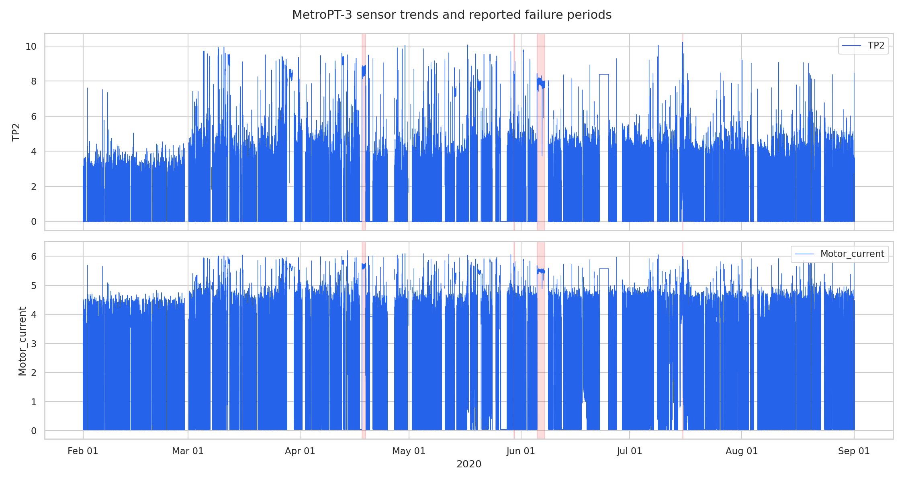
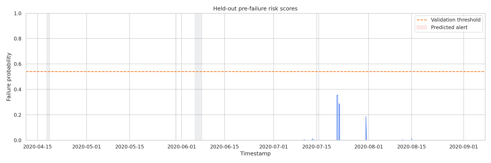
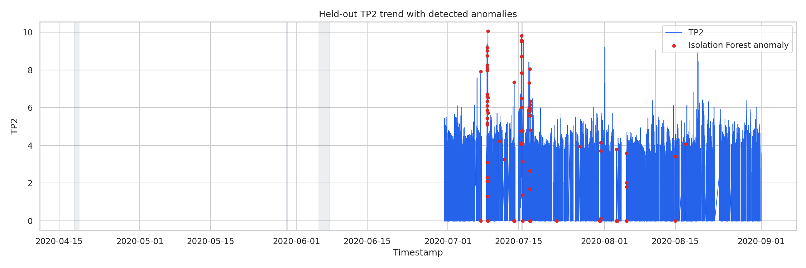

# MetroPT-3 Predictive Maintenance

An end-to-end, reproducible condition-monitoring workflow for the Metro do Porto air-compressor dataset. It downloads the public source data, builds causal rolling-window sensor features, labels pre-failure warning windows from the published failure reports, trains supervised and unsupervised models, and exports metrics, predictions, and plots.

## Quick start

```bash
git clone https://github.com/Brahma-Agni/MetroPT-3-Predictive-Maintenance.git
cd MetroPT-3-Predictive-Maintenance
python -m venv .venv
source .venv/bin/activate        # Windows: .venv\Scripts\activate
python -m pip install -r requirements.txt
python -m src.metropt_pipeline
```

The first run downloads and extracts the 208 MB CSV into `data/raw/`. The raw dataset and generated files are excluded from Git. To use a local copy or change the outputs:

```bash
python -m src.metropt_pipeline --data /path/to/MetroPT3.csv --output reports/generated
```

## Workflow

1. Load, parse, sort, and clean the time-indexed sensor data.
2. Aggregate sensors into five-minute bins and calculate causal rolling means, standard deviations, and three-bin deltas over 15-minute and 60-minute windows.
3. Use UCI's four reported air-leak incidents to mark the six hours before each incident as a positive warning window. Rows inside reported incident intervals are excluded from model splits.
4. Train a class-weighted random forest and set its decision threshold on the earlier chronological validation period to keep the false-positive rate at or below 1%. Report final metrics on the later holdout period. Fit an Isolation Forest on normal training observations for complementary anomaly scores.
5. Save holdout predictions, metrics, sensor/failure plots, a confusion matrix, and feature importances under `reports/generated/`.

## Outputs

- `metrics.json`: chronological split dates, precision, recall, F1, average precision, ROC-AUC, and anomaly rate.
- `holdout_predictions.csv`: timestamped risk probabilities, predictions, anomaly scores, and weak labels.
- `sensor_trends.png`, `holdout_predictions.png`, `detected_anomalies.png`, `confusion_matrix.png`, `feature_importance.png`.

## Results from this run

The included report uses the full UCI dataset. Its chronological holdout spans 2020-06-30 to 2020-09-01 and contains one reported failure with 72 five-minute weak-positive warning windows out of 14,651 rows (0.49%).

| Model | Holdout result |
| --- | --- |
| Random forest | ROC-AUC 0.494, average precision 0.0049, and no alerts at the validation-calibrated 1% false-positive threshold. It did not generalize to the held-out event. |
| Isolation Forest | ROC-AUC 0.986 and average precision 0.135. At the 99th-percentile training-normal cutoff, it flagged 98 windows, including 10 of 72 weak-positive windows (10.2% precision, 13.9% recall). |

The reported anomaly ranking is promising for exploration, but the event count and weak labels are too limited to claim deployment-ready maintenance forecasts. Full metrics and row-level holdout results are in [`reports/`](reports/results.md).

### Sensor trends



### Holdout model scores



### Detected anomalies



## Important interpretation

MetroPT-3 has sensor readings and company failure reports, rather than a row-level failure target. The six-hour warning horizon is an explicit modeling assumption, and the resulting labels are weak labels. There are only four reported incidents, so a chronological holdout contains just one event and metrics can vary substantially with the time split. The random forest's threshold is constrained using validation negatives to avoid an all-alert result on the imbalanced data. Treat the scores as an experiment, not as validated operational alarms. Adjust `--lead-hours` and `--frequency` to explore other assumptions.

## Data and attribution

Davari, N., Veloso, B., Ribeiro, R., & Gama, J. (2021). *MetroPT-3 Dataset*. UCI Machine Learning Repository. [Dataset page](https://archive.ics.uci.edu/dataset/791/metropt+3+dataset), [DOI](https://doi.org/10.24432/C5VW3R). The source dataset is licensed under [CC BY 4.0](https://creativecommons.org/licenses/by/4.0/).

## Stack

Python, Pandas, NumPy, scikit-learn, Matplotlib, and Seaborn.
