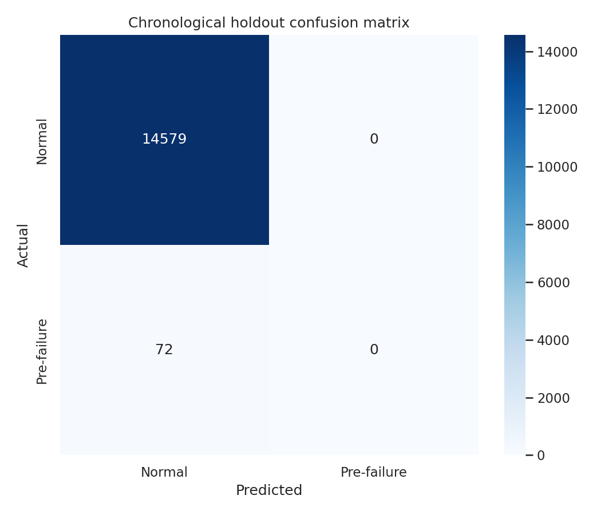
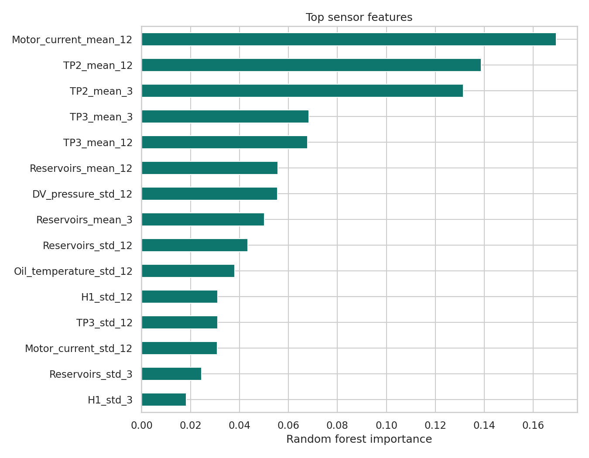

# Full-data run

Generated by the command in the repository README using the complete 1,516,948-row UCI release. The holdout is chronological and contains 14,651 five-minute rows from June 30 through September 1, 2020. The published reports contain four incidents; 72 holdout rows fall in the six-hour weak-label window before the one held-out incident.

## Model metrics

The random forest was calibrated to a 1% maximum false-positive rate on validation negatives. It made no positive predictions on this holdout. Its ROC-AUC was 0.494 and average precision was 0.0049, the same as the holdout prevalence (0.49%). This run did not find useful supervised generalization.

The Isolation Forest was fit to normal training rows. Its score ranking achieved ROC-AUC 0.986 and average precision 0.135 against the weak labels. At the 99th percentile of training-normal anomaly scores, it flagged 98 of 14,651 holdout rows. Ten flags overlapped weak-positive windows, for 10.2% precision and 13.9% recall. This identifies a subset of the reported pre-failure periods, but does not establish operational performance.

The single held-out event, label assumptions, and distribution shift limit these metrics. They should be treated as an exploratory result and not as a production maintenance policy.

## Visuals

### Supervised holdout

### Feature importance

The exact metrics and per-row holdout scores are available in [`metrics.json`](metrics.json) and [`holdout_predictions.csv`](holdout_predictions.csv).
